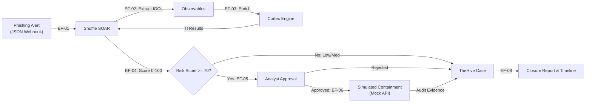

# Anti-Phishing SOAR Platform

An academic Security Orchestration, Automation, and Response (SOAR) platform for automated phishing alert triage, observable enrichment, explainable risk scoring, analyst approval, and simulated containment.

---

## 1. Project Overview

This project implements an end-to-end automated incident response pipeline integrating:
- **Shuffle** — SOAR orchestration and workflow automation.
- **TheHive** — Security incident and case management.
- **Cortex** — Threat intelligence observable analysis and active enrichment.
- **Mock Containment API** — Safe, local simulation layer for containment actions.
- **Docker Socket Proxy** — Hardened security gateway restricting Docker API privileges.

### Core Functional Requirements
- **EF-01:** Ingest phishing alert payloads via JSON webhook.
- **EF-02:** Extract observables (URLs, domains, IPv4/IPv6, SHA256/MD5 hashes, sender addresses).
- **EF-03:** Threat intelligence enrichment via Cortex analyzers.
- **EF-04:** Calculate explainable risk score (0–100) using a deterministic rule matrix.
- **EF-05:** Require human approval before containment for high-risk alerts ($\ge 70$).
- **EF-06:** Simulated containment only (firewall block, mailbox quarantine, account lock) via local mock APIs.
- **EF-07:** Create structured TheHive cases with evidence, observables, and timeline logs.
- **EF-08:** Generate automated incident closure reports and analyst notifications.

---

## 2. System Architecture & Test Categories



### Two Distinct Integration Test Modes
1. **Category 1: Component & Staged API Integration Tests (Isolated Verification)**
   - Used when running within the current 3.82 GiB VM memory boundary.
   - TheHive and Cortex APIs are verified using authentic live REST calls during Stage 1; Shuffle and Mock Containment are verified during Stage 2.
   - Cross-platform verification relies on staged data validation rather than simultaneous cross-network calls.
2. **Category 2: Full Simultaneous Live End-to-End Pipeline (Real-Time Orchestration)**
   - All services run concurrently; Shuffle makes live REST calls across Docker networks to Cortex (`POST /api/analyzer/<id>/run`) and TheHive (`POST /api/case`).
   - Requires **8 GiB VM RAM allocation** to prevent Linux kernel OOM kills.

For full architectural details, see [docs/ARCHITECTURE.md](docs/ARCHITECTURE.md).

---

## 3. Environment & Hardware Constraints

- **Host Operating System:** Ubuntu Desktop 24.04.5 LTS (VirtualBox VM on Windows 10/11 host)
- **Assigned vCPUs:** 3 vCPUs (Ryzen 7 4800H host)
- **Guest Physical RAM (`MemTotal`):** 4,009,584 kB (**3,915.6 MiB / ~3.82 GiB**)
- **Host Desktop Memory Baseline:** **~1,018 MiB** (GNOME Desktop, Xorg, systemd)
- **Unallocated Workload Headroom:** **~2,638 MiB** before memory pressure
- **Swap Partition:** 3,219 MiB on `/dev/sda3`
- **Disk Storage:** 49 GB virtual disk (**28 GB free disk space**)
- **Container Engine:** Docker Engine 29.10.0, Docker Compose v5.8.0
- **Safety Boundary:** Strict simulation mode. No destructive actions or external network modifications. All responses target mock endpoints.

---

## 4. Documentation Index

- [Architecture Specification](docs/ARCHITECTURE.md) — Comprehensive technical architecture, version evaluation matrix, upstream lifecycle analysis, Cortex analyzer modes, socket proxy security, and risk scoring logic.
- [Deployment & Feasibility Guide](docs/DEPLOYMENT.md) — Rigorous memory terminology, reconciled resource budgets, sub-staging vs. 8 GiB upgrade analysis, kernel tuning, and teardown protocols.
- [Project Status & Roadmap](docs/PROJECT_STATUS.md) — Phase tracking, validated findings log, and comparative decision matrix.

---

## 5. Deployment Options & Execution Models

Because full-stack vendor recommendations (12–16 GB) and theoretical down-tuned loads (~5.3 GB) exceed the current VM's 2.63 GiB available RAM, two operational options exist:

### Option B: Primary Recommendation (8 GiB VM Upgrade)
- Allocating 8 GB RAM and 4 vCPUs in VirtualBox leaves ~7.5 GB for the Windows host and expands guest available memory to ~6.8 GB.
- Runs all services concurrently for **Category 2 Full Simultaneous Live End-to-End Integration**.

### Option C: Fallback Execution (Sub-Staged Deployment on Current 3.82 GiB VM)
Runs components in memory-safe sequential stages with clean teardowns between them:
1. **Sub-Stage 1A (Implemented & Validated):** Cassandra 4.0 + Elasticsearch 7.17 + TheHive 4.1.24 (Measured: 1.74 GiB RSS; 1.2 GiB RAM headroom). All 7 API integration tests passed.
2. **Sub-Stage 1B (Implemented & Validated):** Dedicated Elasticsearch 7.17 + Cortex 3.1.8. Process Mode mock analyzer verified (Measured: 1.04 GiB RSS; 1.3 GiB RAM headroom). All 8 API integration tests passed.
3. **Stage 2 (Next Step):** Docker Socket Proxy + Shuffle SOAR + Mock Containment. Verify webhook, risk scoring, approval, and containment.
4. **Stage 3:** Automated Python test harness validates component outputs and generates final closure reports.

### Stage 1A Quickstart & Operations (TheHive Stack)

```bash
# 1. Setup local environment file (never committed to git)
cp infrastructure/docker/.env.example infrastructure/docker/.env

# 2. Start Stage 1A services (Cassandra, Elasticsearch, TheHive)
docker compose -f infrastructure/docker/docker-compose.stage1a.yml --env-file infrastructure/docker/.env up -d

# 3. Run automated validation suite (API tests + resource measurements)
python3 scripts/validate_stage1a.py

# 4. Graceful stop (releases CPU while keeping container state)
docker compose -f infrastructure/docker/docker-compose.stage1a.yml --env-file infrastructure/docker/.env stop

# 5. Full teardown (removes containers, preserves persistent volumes)
docker compose -f infrastructure/docker/docker-compose.stage1a.yml --env-file infrastructure/docker/.env down
```

### Stage 1B Quickstart & Operations (Cortex Stack)

```bash
# 1. Start Stage 1B services (Dedicated Elasticsearch, Cortex)
docker compose -f infrastructure/docker/docker-compose.stage1b.yml --env-file infrastructure/docker/.env up -d

# 2. Run automated validation suite (API tests + Process analyzer execution)
python3 scripts/validate_stage1b.py

# 3. Graceful stop (releases memory before starting another stage)
docker compose -f infrastructure/docker/docker-compose.stage1b.yml --env-file infrastructure/docker/.env stop

# 4. Full teardown (removes containers, preserves persistent volumes)
docker compose -f infrastructure/docker/docker-compose.stage1b.yml --env-file infrastructure/docker/.env down
```

---

## 6. Project Directory Layout

```
anti-phishing-soar/
├── .gitignore                 # Excludes environment files and secrets
├── AGENTS.md                  # Project instructions & safety rules
├── README.md                  # Project overview and quick start
├── docs/                      # Technical documentation
│   ├── ARCHITECTURE.md        # Comprehensive architecture & security specification
│   ├── DEPLOYMENT.md          # Hardware feasibility & staged deployment guide
│   └── PROJECT_STATUS.md      # Phase tracking & decision log
├── infrastructure/            # Docker Compose & service configurations
│   ├── cortex/                # Cortex configs and analyzer templates
│   │   ├── application.conf   # Cortex Play framework & ES backend config
│   │   └── analyzers/         # Local Process mode analyzers
│   │       └── MockPhishing/  # Mock threat intelligence analyzer
│   ├── docker/                # Modular Docker Compose files
│   │   ├── .env.example       # Template environment variables
│   │   ├── .env               # Active credentials (git-ignored)
│   │   ├── docker-compose.stage1a.yml # Stage 1A stack definition (TheHive)
│   │   └── docker-compose.stage1b.yml # Stage 1B stack definition (Cortex)
│   ├── shuffle/               # Shuffle workflow configurations
│   └── thehive/               # TheHive application configs
│       └── application.conf   # TheHive 4 JanusGraph configuration
├── playbooks/                 # Exported Shuffle playbooks and workflows
├── scripts/                   # Test automation and validation scripts
│   ├── validate_stage1a.py    # Automated test runner & metrics reporter (Stage 1A)
│   └── validate_stage1b.py    # Automated test runner & metrics reporter (Stage 1B)
├── evidence/                  # Audit logs, containment proofs, and case reports
└── tests/                     # Unit and integration test suites
    ├── test_stage1a_thehive.py # Stage 1A API & persistence test suite
    └── test_stage1b_cortex.py  # Stage 1B API & analyzer test suite
```
