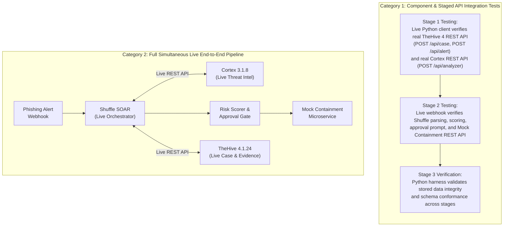

# Architecture Specification — Anti-Phishing SOAR Platform

## 1. Executive Summary & Context

This document defines the architectural specification for the academic **Anti-Phishing SOAR** platform following the Phase 1.7 architecture validation. The objective is to design a realistic, secure, and academically rigorous implementation integrating:
- **Shuffle** — SOAR orchestration and workflow automation.
- **TheHive** — Security incident and case management.
- **Cortex** — Threat intelligence observable analysis and active enrichment.
- **Mock Containment API** — Non-destructive simulation microservice.

This revision reconciles resource budgets, validates integration lifecycles, assesses upstream software status, verifies Cortex analyzer execution mechanisms, hardens Docker socket access, and evaluates VM hardware scaling options.

---

## 2. Upstream Ecosystem & Component Analysis

### 2.1 Upstream Lifecycle Status & TheHive 4.1.24 Reassessment
1. **Upstream TheHive GitHub Repository Archived:**
   The primary upstream open-source repository ([TheHive-Project/TheHive](https://github.com/TheHive-Project/TheHive)) was officially archived by maintainers on **December 5, 2025**. It is permanently read-only; no new bug fixes, security patches, or dependency updates will ever be released.
2. **TheHive 4.1.24 Status:**
   Released in **September 2022**, TheHive `4.1.24` reached formal End-of-Life (EOL) on **December 31, 2022**. It is **unmaintained legacy software**.
3. **Maintenance and Security Implications:**
   - **Zero Upstream Maintenance:** Any discovered vulnerabilities in TheHive 4 or its underlying stack (Play Framework 2.8, Akka 2.6, JanusGraph 0.5, Elastic4s, Log4j/Logback) will remain unpatched.
   - **CVE Exposure:** Outdated frameworks contain documented vulnerabilities. In an enterprise production network, TheHive 4 would fail compliance and vulnerability audits.
   - **Academic Mitigation:** In this lab, TheHive is restricted to isolated Docker bridge networks and localhost loopback (`127.0.0.1`), entirely shielded from public inbound routing.
4. **Academic Justification for TheHive 4.1.24:**
   - **True Open-Source Licensing (AGPLv3):** TheHive 4.x is the final major release distributed under a pure AGPLv3 license.
   - **Zero SaaS / Cloud Licensing Overhead:** Starting with TheHive 5, StrangeBee transitioned to a commercial licensing model. The "Community Edition" requires registration on `my.strangebee.com`, generation of a hardware machine challenge string, downloading an activation token file, and periodic renewal (with a 2-seat limit). Cloud key validation and expiration create severe operational friction and failure points in automated academic grading environments.
   - **Deterministic Offline Reproducibility:** TheHive 4 can initialize and operate completely offline without external license validation servers.
5. **Specification Compliance:**
   - The project requirements (`AGENTS.md`) specify: *"TheHive for incident and case management"*.
   - The specification **does not mandate a specific version of TheHive**. Selecting TheHive 4 is a conscious engineering compromise favoring open-source reproducibility over software currency, with its legacy status fully acknowledged.

### 2.2 StrangeBee Compatibility & Isolation Rules
- Cortex `3.2.1` and earlier require **Elasticsearch 7.x**.
- Cortex `4.x` requires **Elasticsearch 8.x** (Elasticsearch 7 support was dropped).
- StrangeBee explicitly documents: **"Sharing an Elasticsearch instance between TheHive and Cortex is not recommended."** Running both against one instance introduces mapping conflicts, index contention, and mutual downtime.

### 2.3 Shuffle Resource Demands
- Shuffle documentation specifies a **minimum of 4 GB RAM for testing** and recommends **8 GB RAM**.
- Shuffle's default `docker-compose.yml` deploys OpenSearch configured with a **3 GB heap** (`-Xms3g -Xmx3g`) by default.

---

## 3. Version Selection Evaluation Matrix

We evaluate three candidate platform stacks:

| Attribute | Stack 1: Legacy Open-Source | Stack 2: Hybrid Transition | Stack 3: Modern Enterprise |
| :--- | :--- | :--- | :--- |
| **Component Versions** | TheHive `4.1.24-1` Cortex `3.1.8` / `3.2.1` Elasticsearch `7.17.9` Cassandra `4.0` | TheHive `5.2.x` Cortex `3.2.1` Elasticsearch `7.17.9` Cassandra `4.1` | TheHive `5.8+` / `6.0` Cortex `4.0.x` Elasticsearch `8.x` (x2) or OpenSearch Cassandra `4.1` |
| **Maintenance Status** | **Unmaintained & Archived** (TheHive repo archived Dec 5, 2025; TheHive 4 EOL Dec 2022; ES 7.17 EOL 2023) | **Deprecated / Older 5.x Branch** (TheHive 5.2 superseded; Cortex 3.x superseded by 4.x; ES 7.17 EOL) | **Actively Maintained** (StrangeBee commercial releases; Cortex 4 on ES 8 actively maintained) |
| **License & Registration** | **AGPLv3** (100% Free Open Source). Zero registration, no license keys, no seat limits, fully offline. | **StrangeBee Community Edition**. Requires portal registration, machine challenge string, license key token. 2-seat limit. | **StrangeBee Commercial / Community**. Mandatory portal registration, machine challenge, license activation file. |
| **Elasticsearch Dependency** | ES `7.17.x` shared (functional in lab, though not recommended by vendor). Incompatible with ES 8. | ES `7.17.x` shared. Incompatible with ES 8. | **Dual Cluster Mandatory:** Cortex 4.x strictly requires ES 8; TheHive 5/6 requires ES 8 / OpenSearch. Vendor prohibits sharing. |
| **Cassandra Dependency** | Cassandra `3.11` / `4.0` (JanusGraph). Cortex does not use Cassandra. | Cassandra `4.0` / `4.1` (JanusGraph). Cortex does not use Cassandra. | Cassandra `4.1` / ScyllaDB. Cortex does not use Cassandra. |
| **Docker Images** | Available on Docker Hub: `thehiveproject/thehive4:4.1.24-1` `thehiveproject/cortex:3.1.8` `elasticsearch:7.17.9` `cassandra:4.0` | Available on Docker Hub: `strangebee/thehive:5.2` `thehiveproject/cortex:3.2.1` `elasticsearch:7.17.9` `cassandra:4.1` | Available on Docker Hub: `strangebee/thehive:5.8` `thehiveproject/cortex:4.0.1-1` `elasticsearch:8.15.x` `cassandra:4.1` |
| **API Integration Feasibility** | **High:** Native Shuffle TheHive 4 app (`/api/case`, `/api/alert`). Cortex REST API (`/api/analyzer`). Built-in compatibility. | **Moderate:** Shuffle TheHive 5 app available. Requires managing license tokens before APIs respond. | **Complex / Infeasible on VM:** Dual search engines + Cassandra + TheHive + Cortex + Shuffle = 5 distinct JVMs. |

---

## 4. Cortex Analyzer Execution Verification

### 4.1 Execution Backend Analysis
Cortex provides two distinct mechanisms for executing analyzer jobs:
1. **Docker Container Execution (Recommended by StrangeBee for Cortex 3+):**
   - Cortex calls the Docker daemon via `/var/run/docker.sock` to dynamically spawn an ephemeral container for each job using official images (`cortexneurons/<analyzer-name>:<version>`).
   - *Pros:* Complete dependency isolation; no Python version conflicts; zero host package clutter.
   - *Cons:* Requires Docker socket access inside Cortex; pulls dozens of container images (consuming several GBs of disk space); adds container startup latency.
2. **Local Process Execution (Legacy / Standalone Mode):**
   - Cortex directly spawns an external process (`fork`/`exec`) running the analyzer Python script (e.g. `python3 virustotal_analyzer.py`).
   - *Pros:* Instantaneous execution; zero Docker socket privileges required for Cortex; minimal memory overhead.
   - *Cons:* All Python dependencies (`cortexutils`, `requests`, system libraries) must be installed in the environment where Cortex runs.

### 4.2 Compatibility & Dependency Findings
- **Can all analyzers run as local processes?**
  **NO.** Many advanced analyzers (e.g., YARA, Cuckoo sandbox integration, dynamic malware extractors, PDF parsers) require complex compiled C-libraries (`libfuzzy`, `libmagic`, `ssdeep`, `msoffcrypto-tool`) or local sandboxes that fail or conflict in a shared process environment.
- **Phishing Pipeline Analyzer Selection:**
  For our functional requirements (EF-02, EF-03: enrich URLs, domains, IP addresses, file hashes, sender addresses using $\ge 2$ threat-intel sources), the selected analyzers are:
  1. **VirusTotal Analyzer** (URL, domain, IP, hash lookup): Pure HTTP REST API client.
  2. **AbuseIPDB / URLhaus Analyzer** (IP/URL reputation): Pure HTTP REST API client.
- **Process Mode Feasibility for Target Analyzers:**
  Because the chosen analyzers are lightweight REST API wrappers, they **can** run via Process Mode without Docker, provided that:
  - Python 3 is available in the Cortex execution container.
  - Analyzer scripts adhere to the Cortex Process protocol: accepting `<job_directory>` as argument, reading `<job_directory>/input/input.json`, and writing results to `<job_directory>/output/output.json`.
  - Valid API keys are configured in Cortex organization analyzer settings.
- **Empirical Process Mode Verification (Stage 1B):**
  - Implemented standalone Python process analyzer `MockPhishing` mounted at `/opt/cortex/analyzers`.
  - Cortex 3.1.8 successfully discovered `MockPhishing_1_0` definition without external dependencies.
  - Successfully executed observable analysis jobs for phishing URLs and extracted structured taxonomy and threat verdict in ~2 seconds with zero Docker daemon access.

---

## 5. Docker Socket Security Architecture

### 5.1 Privileges Granted by `/var/run/docker.sock`
Mounting `/var/run/docker.sock` directly into a container provides unrestricted root privileges over the host operating system:
1. **Host Filesystem Escalation:** A container with raw socket access can execute `docker run -v /:/host alpine` and read/modify any host file, including `/etc/shadow` and `/etc/sudoers`.
2. **Privileged Container Spawning:** Containers can be started with `--privileged` and `--cap-add=ALL`, bypassing Linux cgroups, user namespaces, and seccomp filters.
3. **Lateral Container Hijacking:** Any container process with raw socket access can inspect, stop, or inject code into other running containers on the host.

### 5.2 Shuffle Orborus API Requirements
Shuffle Orborus acts as a container orchestrator that dynamically spawns `shuffle-worker` containers to execute individual workflow actions. To function, it requires specific Docker API calls:

| Permission Variable | Docker API Endpoints | Operational Reason for Orborus | Impact if Blocked (`=0`) |
| :--- | :--- | :--- | :--- |
| **`CONTAINERS=1`** | `/containers/create` `/containers/{id}/start` `/containers/{id}/json` `/containers/{id}/logs` `/containers/{id}/wait` `/containers/{id}` (DELETE) | Orborus must create, start, stream logs from, wait for exit codes, and remove ephemeral worker containers. | **Fatal:** Orborus cannot create or manage worker containers; all workflow actions fail immediately. |
| **`IMAGES=1`** | `/images/json` `/images/{name}/json` `/images/create` | Orborus inspects local worker images and pulls missing app worker images from GitHub Container Registry. | **Fatal:** Orborus cannot verify or pull `shuffle-worker` images. |
| **`NETWORKS=1`** | `/networks/json` `/networks/{id}/connect` | Ephemeral worker containers must be attached to the internal `shuffle_backend_net` network to send output back to Shuffle Backend. | **Fatal:** Workers cannot route traffic to Shuffle Backend; workflow executions time out. |
| **`POST=1`** | HTTP `POST` method on allowed endpoints | In the Docker Engine REST API, container creation (`POST /containers/create`), container startup (`POST /containers/{id}/start`), image pull (`POST /images/create`), and network connection (`POST /networks/{id}/connect`) are strictly `POST` requests. | **Fatal:** The proxy returns HTTP `403 Forbidden` on all mutation requests. Only read-only `GET` queries would succeed. |

### 5.3 Strictly Prohibited API Categories (Hardened Least-Privilege Policy)
The following permissions are explicitly disabled (`=0`) in the socket proxy configuration:
- `VOLUMES=0` — Blocks `/volumes/*`. Prevents worker containers from mounting host storage paths or creating unmanaged volumes.
- `EXEC=0` — Blocks `/containers/{id}/exec`. Prevents executing interactive commands or backdoor processes inside existing containers.
- `INFO=0` & `SYSTEM=0` — Blocks host system metadata and Docker daemon telemetry leakage.
- `SWARM=0` & `NODES=0` — Blocks Docker Swarm clustering endpoints.
- `SECRETS=0` & `CONFIGS=0` — Blocks Swarm secret storage access.
- `AUTH=0` & `BUILD=0` — Prevents modifying registry authentication and building Dockerfiles.

### 5.4 Network Isolation Rule
- The socket proxy container **NEVER exposes port 2375 to the host network** (i.e. `ports: - "2375:2375"` is strictly prohibited).
- The proxy is accessible **only** within an internal Docker bridge network (`expose: ["2375"]`), reachable exclusively by Shuffle Orborus.
- Cortex is configured in **Process Mode**, completely eliminating Cortex's need to access `/var/run/docker.sock` or the socket proxy.

---

## 6. Validation of the Integration Lifecycle

### 6.1 Analysis of the Sequential (Stopped-Service) Lifecycle
In Phase 1.6, a staged deployment was proposed where Stage 1 (TheHive/Cortex) is stopped before Stage 2 (Shuffle) is started.
- **Technical Reality:** When TheHive and Cortex containers are stopped, their HTTP REST endpoints (`http://thehive:9000` and `http://cortex:9001`) are completely offline and unreachable.
- **Implication:** Shuffle **cannot perform live REST calls to TheHive or Cortex while they are stopped**.
- If Shuffle relies on cached responses, local mock stubs, or pre-recorded fixtures during Stage 2, that constitutes **mocked/simulated integration**, NOT live platform integration.

### 6.2 Definition of Two Distinct Test Categories

To ensure academic and technical integrity, we explicitly distinguish between two test categories:

1. **Category 1: Component & Staged API Integration Tests (Isolated Verification)**
   - Used when host memory is constrained to $\le 4$ GiB.
   - Each real component is deployed and tested with authentic, live REST API calls during its dedicated stage.
   - Schema validation, authentication headers, and database persistence are verified against the real platforms.
   - *Limitation:* Live inter-platform network calls (Shuffle $\leftrightarrow$ TheHive/Cortex) do not occur simultaneously; cross-platform verification relies on staged data validation.
2. **Category 2: Full Simultaneous Live End-to-End Tests (Real-Time Pipeline)**
   - All services (Shuffle, TheHive, Cortex, Elasticsearch, Cassandra, Socket Proxy, Mock Containment) run concurrently.
   - Shuffle actively initiates real-time HTTP REST calls to Cortex (`POST /api/analyzer/<id>/run`) to enrich observables, calculates the risk score, requests analyst approval, triggers the Mock Containment API, and creates cases/alerts directly in TheHive (`POST /api/case`) with evidence attachments and timeline events.
   - *Hardware Requirement:* Requires **8 GiB VM RAM allocation** to avoid OOM termination.

---

## 7. Comparative Architecture Decision Matrix

| Metric / Dimension | Option A: Monolithic Deployment on Current 3.82 GiB VM | Option B: 8 GiB VM Allocation with Live Simultaneous Pipeline | Option C: Sub-Staged Sequential Deployment on Current 3.82 GiB VM | Option D: Alternative Custom Microservice Stack |
| :--- | :--- | :--- | :--- | :--- |
| **RAM Requirement** | ~5.3 GiB RSS vs. 2.63 GiB available | ~5.3 GiB RSS vs. 6.8 GiB available | ~2.0 GiB RSS per stage vs. 2.63 GiB available | ~1.5 GiB RSS vs. 2.63 GiB available |
| **Feasibility Status** | **INFEASIBLE (Guaranteed OOM Kill)** | **FEASIBLE (Full Live Operation)** | **FEASIBLE (Within Memory Limits)** | **FEASIBLE (Lightweight)** |
| **Live Inter-Service REST API Calls** | Fails immediately (crashes) | **Yes — 100% Live Real-Time Integration (Category 2)** | No — Decoupled staged API tests (Category 1) | Partial (Depends on custom mocks) |
| **TheHive / Cortex Authenticity** | Real containers (crash on boot) | **Real TheHive 4 + Cortex 3 containers** | Real TheHive 4 + Cortex 3 containers | Replaced by lightweight custom mock APIs |
| **Shuffle SOAR Authenticity** | Real Shuffle (crashes on boot) | **Real Shuffle SOAR + Orborus worker** | Real Shuffle SOAR + Orborus worker | Real or custom orchestrator |
| **Security Posture** | Poor (Direct socket) | **Hardened (Filtered Socket Proxy + Process Analyzers)** | Hardened (Filtered Socket Proxy + Process Analyzers) | Hardened |
| **Academic Fidelity** | Zero (Broken deployment) | **Maximum (Authentic Live Enterprise Pipeline)** | High for components; Limited for live E2E | Low (Core platforms replaced by mocks) |
| **Verdict** | **REJECTED** | **PRIMARY RECOMMENDATION** | **OFFICIAL FALLBACK RECOMMENDATION** | **REJECTED** |

---

## 8. Summary of Recommendation

1. **Primary Recommendation (Option B — 8 GiB VM Allocation):**
   - The user/operator allocates **8 GB RAM and 4 vCPUs** in VirtualBox settings.
   - This unlocks **Category 2 Full Simultaneous Live End-to-End Testing**, running real Shuffle, real TheHive 4, real Cortex 3, real Elasticsearch, and real Cassandra concurrently without memory pressure or swap thrashing.
2. **Fallback Recommendation (Option C — Sub-Staged Deployment on Current 3.82 GiB VM):**
   - If the VM must remain at its current 3.82 GiB RAM allocation, the project executes **Option C**.
   - Stage 1 is divided into sub-stages (Stage 1A: TheHive+ES+Cassandra; Stage 1B: Cortex+ES) to maintain a defensible memory budget.
   - Testing is strictly scoped to **Category 1 Staged API Integration Tests**, with documented academic limitations regarding simultaneous cross-platform calls.
